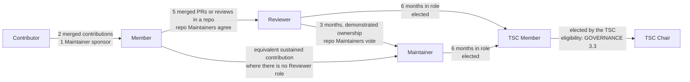
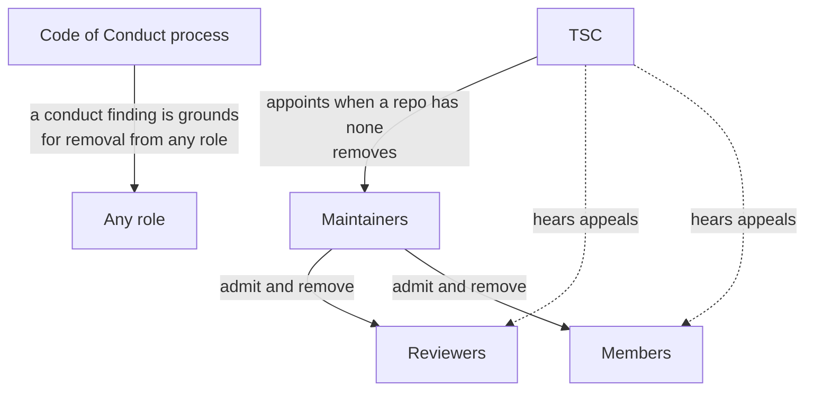

# ANS Contributor Ladder

This describes the roles in the Agent Name Service (ANS) project: what each
one is for, how you get there, and how you leave. It is the "Ladder" referred
to in Section 2.e of the [Charter](CHARTER.md). Process details it refers to
are in [GOVERNANCE.md](GOVERNANCE.md). Where a table or diagram and a role's
section below disagree, the section wins.

There are two tracks.

The **contributor track** is cumulative: Contributor, Member, Reviewer,
Maintainer. Each role includes the responsibilities and privileges of the one
before it, so a Maintainer is also a Reviewer and a Member and is held to
everything those roles ask. "Approver" and "Committer" are older names for
Maintainer; you will see them in Linux Foundation documents.

The **governance track** is separate: TSC Member and TSC Chair. Being a
Maintainer does not make anyone a TSC member. During the Startup Period a
TSC member need not hold a contributor-track role; from the first election
of TSC members onward, every TSC candidate must be a Maintainer or Reviewer.
The Chair and Vice Chair must be Maintainers except for the one-time waiver
for their initial elections and terms following Charter adoption
(GOVERNANCE.md Section 3.3). Advisor is a governance-track role without a
vote. Emeritus is recognition for former contributor-track roles.

## Summary

### Contributor track: the GitHub roles

These are the roles that map to GitHub permissions.

| Role | Scope | GitHub access | What you can do | How you get it | How you lose it |
| --- | --- | --- | --- | --- | --- |
| Contributor | Project | Fork and open pull requests | Open issues and pull requests, join discussions | Show up | Code of Conduct action only |
| Member | Organization | Organization member; triage on the repositories you are active in | Triage issues, be assigned work, CI runs without approval; vote in TSC elections while active | Two merged contributions over two months, one Maintainer sponsor | 12 months inactive, or two Maintainers for cause |
| Reviewer | One repository | Write, through the repository's reviewers team, so GitHub counts your approval; cannot merge; listed in `CODEOWNERS` for your area | Your approval counts toward merge requirements; vote in TSC elections | Five merged reviews or PRs over three months, one Maintainer sponsor, repo Maintainers agree | 6 months inactive in that repo, or the repo's Maintainers for cause |
| Maintainer | One repository | Write, through the repository's maintainers team | Merge, release, respond to security reports; vote in TSC elections | Three months as Reviewer with demonstrated ownership, repo Maintainers vote | 6 months inactive, or removal by TSC |
| Emeritus | Recognition | None | Listed as a former Reviewer or Maintainer | Step down or age out | Reinstatement or 12 months |

### Governance track

TSC members hold Write access across the active project repositories through
`@agentnameservice/tsc`, whose membership comes from the voting-member table in
[TSC.md](TSC.md). The team is listed in CODEOWNERS so its fallback reviews can
satisfy GitHub's required review checks (GOVERNANCE.md Section 7). This access
does not appoint anyone as a repository Maintainer or grant them merge rights
on code, specification, or package repositories. Those merges remain with the
repository's Maintainer team.

TSC members may merge in `governance`; the Chair and Vice Chair may merge in
`.github` through `@agentnameservice/tsc-owners`. These are governance roles,
not Maintainer appointments. The Chair and Vice Chair are organization owners;
ordinary TSC members do not receive Admin access. Review, DCO, CI, and the
applicable decision rules still apply.

| Role | Scope | What you can do | How you get it | How you lose it |
| --- | --- | --- | --- | --- |
| TSC Member | Project | Vote on project decisions | Elected from Maintainers and Reviewers (Section 3.2 of GOVERNANCE.md) | Missed votes, 90 days silence, or removal by two-thirds |
| TSC Chair | Project | Run the TSC, own the administration; organization owner | Elected by the TSC from its seated members; Maintainer required except for the initial-election waiver (GOVERNANCE.md Section 3.3) | Replaced by TSC majority |
| Vice Chair | Project | Stand in for the Chair, run elections; organization owner | Elected by the TSC from its seated members; Maintainer required except for the initial-election waiver (GOVERNANCE.md Section 3.3) | Replaced by TSC majority |
| Advisor | Project | Consulted on proposals, may attend TSC calls, no vote | Named by the TSC | Removed by the TSC, or by asking |

## Commitments and what happens if you go quiet

These are the tables an initial TSC member or Maintainer is asked to read and
accept. Days are calendar days. Away notes and quiet periods pause these
clocks, except the Member one.

### Contributor track

| Role | You are responsible for | You commit to | If you go quiet |
| --- | --- | --- | --- |
| Contributor | Following the Code of Conduct, signing off commits, linking an issue | Nothing beyond that | Nothing. A pull request waiting on you for 60 days gets a reminder and closes 30 days later, reopenable. |
| Member | Triage, helping newcomers, staying involved | Keeping two-factor authentication on | 12 months with no activity: removed after a 14-day heads-up. For cause: two Maintainers. Ask again any time. |
| Reviewer | Everything a Member is, plus reviewing pull requests in your area and knowing the spec sections it implements | Acknowledging review requests within 10 days unless marked away | 6 months with no activity in the repo: Emeritus. For cause: the repo's Maintainers. Reinstated within 12 months by the repo's Maintainers' lazy consensus. |
| Maintainer | Everything a Reviewer is, plus reviewing and merging, CI and dependencies, releases, security response, keeping `MAINTAINERS.md` and `CODEOWNERS` current, mentoring, SDK/reference-implementation work for normative specification changes or an explicit deferral before a spec tag, input to the health check | Acknowledging within 10 days unless marked away; as a team, acknowledging security reports within 3 business days | 6 months inactive: the Chair asks, 14 days without reply means Emeritus by TSC lazy consensus. Repeated rule-breaking or a conduct finding: removed by TSC majority. Whole repo silent for 30 days: interim Maintainers appointed. |
| Emeritus | Nothing | Nothing | Nothing. After 12 months, coming back means the normal path. |

### Governance track

| Role | You are responsible for | You commit to | If you go quiet |
| --- | --- | --- | --- |
| TSC Member | Technical direction, closing governance and repository proposals, appointing Maintainers where a repository has none, disclosing conflicts | Voting or abstaining on every vote; replying to the Chair or other members within 14 days; a two-year term | 3 missed votes or 90 days of silence: the Chair asks, 14 days without reply and the seat can be vacated by majority. Cause: two-thirds of the other members. |
| TSC Chair | Everything a TSC member does, plus: LF contact, organization owner and access review, running votes and writing decision records, the quarterly health check, meeting notices and notes, applying these inactivity rules | Replying to LF within 10 business days; a health check every quarter; the recording link the same day and notes within seven days of any call | Health check not opened by day 15 of a quarter, or election not started: the Vice Chair steps in, then any TSC member. Replaceable by TSC majority at any time. |
| Vice Chair | Standing in for the Chair; running elections; second organization owner | Same as a TSC member, plus acting when the Chair has not within the stated time | Same as a TSC member. Replaceable by TSC majority at any time. |
| Advisor | Giving an opinion when asked | Nothing | Nothing. The TSC may drop Advisors who never respond. |

## Contributor

Anyone who takes part. You do not need permission.

- **What you do.** Open issues, send pull requests, review other people's
  pull requests, answer questions, improve documentation, report security
  issues privately.
- **Requirements.** Follow the [Code of Conduct](CODE_OF_CONDUCT.md). Sign
  off every commit (see [CONTRIBUTING.md](CONTRIBUTING.md)).
- **Recognition.** Your name is in the git history and the release notes.

## Member

A Contributor who has stuck around and whom the project trusts with a little
more access. Membership is public: you appear as a member of the
`agentnameservice` GitHub organization.

- **Responsibilities.** Keep contributing. Help triage issues. Help
  newcomers. Follow the Code of Conduct and hold others to it.
- **Requirements.**
  - At least two merged, non-trivial contributions across at least two
    months. Documentation, triage, and substantive review count as
    contributions.
  - One Maintainer of any repository sponsors you.
  - Two-factor authentication enabled on your GitHub account.
- **Privileges.** Organization membership. Triage permission on the
  repositories you are active in, so you can label and assign issues. CI runs
  on your pull requests without a Maintainer approving the run. You can be
  requested as a reviewer. You vote in TSC elections while you have been
  active in the last 12 months.
- **How.** Open a Member request issue in this repository (there is a
  form), link your contributions, and name your sponsor. The sponsor
  confirms with a comment, and that confirmation is the decision. An
  organization owner sends the invite within seven days.
- **Leaving.** 12 months without any activity in the project. A Maintainer
  tells you first and waits 14 days. For cause, two Maintainers agreeing,
  with the reasons given to you in writing. The TSC does not remove Members;
  it hears appeals. You can ask again at any time. A Code of Conduct finding
  can also end membership.

At donation, the initial TSC offers Membership to every contributor who
already meets the requirements above.

## Reviewer

A Member who knows part of the code or specification well enough that their
review carries weight. Reviewer is scoped to one repository, or to a path in
it. The repository's `MAINTAINERS.md` identifies the team; its membership and
access are recorded in the organization `peribolos.yml`. `CODEOWNERS` routes
reviews to the appropriate team or path.

- **Responsibilities.** Everything a Member does, plus: reply to review
  requests in your area within 10 days when you are not marked away. Know the
  specification sections your area implements. Raise concerns early and
  clearly. Say when something is outside your competence.
- **Requirements.**
  - Member.
  - Authored or substantively reviewed at least five merged pull requests in
    the repository over at least three months.
  - One Maintainer of the repository sponsors you.
  - The repository's Maintainers agree by lazy consensus (five days).
- **Privileges.** Your approval counts toward the approval requirements in
  Sections 6 and 7 of GOVERNANCE.md. You are auto-requested on pull requests
  touching your area. You hold write access through the repository's
  reviewers team only so that GitHub counts your approval; branch protection
  restricts merging to the maintainers team, and for a normative
  specification change at least one approver still has to be a Maintainer.
  You vote in TSC elections and may run for the TSC after six months as a
  Reviewer (no minimum at the first election).
- **How.** A Maintainer of the repository opens a Reviewer nomination issue
  there (there is a form) with the evidence. After five days with no
  Maintainer objection, they propose the team-membership change in
  `peribolos.yml` and update review routing if needed. An organization owner
  ensures the change is applied within seven days of the reviewed PR's merge;
  the change is not complete until the access is updated.
- **Leaving.** Six months without activity in that repository moves you to
  Emeritus. For cause, the repository's Maintainers decide by lazy consensus
  (five days), with the reasons given to you in writing. The TSC does not
  remove Reviewers; it hears appeals. You can step down at any time by pull
  request against the team configuration.

A small repository may have no Reviewers. That is fine. The role exists so
people have a way to grow into Maintainer, not because every repository needs
it.

## Maintainer

The people responsible for a repository. Maintainer is scoped to one
repository; a person can be a Maintainer of several. The repository's
`MAINTAINERS.md` and the org-level [index](MAINTAINERS.md) identify its
Maintainer team. Current membership is recorded in `peribolos.yml`.

- **Responsibilities.** Everything a Reviewer does, plus:
  - Review and merge pull requests under the rules in GOVERNANCE.md, and
    reply to review requests within 10 days when you are not marked away.
  - Keep CI, dependencies, and releases healthy.
  - Handle security reports for the repository (see
    [SECURITY.md](SECURITY.md)).
  - For maintained SDKs and the reference implementation, complete the
    implementation work for normative specification changes before the
    specification release is tagged, or record a deferral under Section 6.3
    of GOVERNANCE.md.
  - Keep `MAINTAINERS.md` and `CODEOWNERS` current.
  - Mentor Reviewers and Members.
  - Take part in the quarterly health check.
- **Requirements.**
  - Reviewer for at least three months, or equivalent sustained contribution
    where the repository has had no Reviewer role.
  - Demonstrated ownership: for example, shipped a feature end to end, fixed
    bugs other people reported, handled a release or a CI failure, or drove a
    specification change through the process.
  - Understands the specification sections the repository implements.
  - Nominated by a Maintainer of the repository with the Maintainer
    nomination form. A majority of that repository's Maintainers approve in
    a seven-day vote in that issue.
  - If a repository has no Maintainers, because it is new or they have all
    left, the TSC appoints them directly.
- **How.** The nominator opens the pull request that updates the Maintainer
  team's membership in `peribolos.yml`, linking the nomination decision.
  Update repository/team references or `CODEOWNERS` if the team itself changes.
  An organization owner ensures the reviewed change is applied within seven
  days of the merge; the change is not complete until the access is updated.
  Removals follow the same process.
- **Interim Maintainers.** When a repository's reviewing pool has not
  responded to anything for 30 days (GOVERNANCE.md Section 7), the TSC may
  appoint interim Maintainers by majority vote in a `tsc-decision` issue, at
  any time and not only at the health check. They hold full Maintainer
  privileges and are listed in `MAINTAINERS.md` with an "interim until" date.
  They are confirmed as Maintainers or removed at the next health check, or
  when the original Maintainers respond, whichever comes first.
- **Privileges.** Write access through the repository's maintainers team.
  Merge and release. Vote in TSC elections. Eligible to run for the TSC after
  six months as a Maintainer (no minimum at the first election).
- **Leaving.**
  - **Inactivity.** Six months without Maintainer activity in a repository
    that had things needing one. The Chair asks whether you want to continue. No reply within 14 days
    moves you to Emeritus by lazy consensus of the TSC.
  - **For cause.** Repeatedly merging changes that break the review rules, or
    a Code of Conduct finding. TSC majority vote (Charter 2.e.iii).
  - **Stepping down.** Any time, by pull request. Please announce it and hand
    over anything in flight.

At donation, the initial Maintainers of each repository are those listed in
[MAINTAINERS.md](MAINTAINERS.md), chosen by the initial TSC.

## TSC Member

Elected by the active Members, Reviewers, and Maintainers to steer the
project. After the
Startup Period, every candidate, incumbent or not, must be a Maintainer or
Reviewer. Composition, elections, expectations, and removal are in Section 3
of [GOVERNANCE.md](GOVERNANCE.md). In short: two-year staggered terms, one
organization cannot hold more than the Charter cap, vote or abstain on everything, and a
seat that goes quiet for 90 days can be declared vacant.

## TSC Chair (project lead)

The TSC member who owns the running of the project. Eligibility for both the
Chair and Vice Chair, including the one-time Maintainer waiver for their
initial elections and terms following Charter adoption, is defined in
Section 3.3 of [GOVERNANCE.md](GOVERNANCE.md).

The Chair owns LF liaison, GitHub organization administration, votes and
decision records, the quarterly health check, and making sure the rules in
this document are applied. The Vice Chair stands in when the Chair has not
acted within the stated time, runs elections, and is the second organization
owner. Portfolios (Section 3.6 of GOVERNANCE.md) spread the rest of the
administrative work across the TSC.

## Advisor

Someone the TSC wants to hear from without asking them to carry a seat. Named
by the TSC by lazy consensus under Charter 2.g and listed in
[TSC.md](TSC.md). Typical Advisors are co-authors of the original
specification, liaisons to other standards bodies, and operators of large
deployments.

- **What you do.** Give an opinion when a proposal or the TSC asks for one.
  Attend TSC calls if you want to.
- **What you do not do.** Vote, merge, or hold access. Advisors do not count
  toward quorum or the organization cap, and are not eligible to run for the
  TSC on the strength of the role alone.
- **Leaving.** Ask, or the TSC removes the listing by lazy consensus. There
  is no inactivity clock because there is no obligation.

## Emeritus

Recognition for former Reviewers and Maintainers. Listed under "Emeritus" in
the relevant `MAINTAINERS.md`. No access.

- Within 12 months of leaving, a former Maintainer or Reviewer can be
  reinstated to their previous role by lazy consensus (five days) of the
  repository's current Maintainers. No need to climb again.
- After 12 months, the normal process applies, though prior history
  counts as evidence.

## Who grants and removes each role

Each level manages the one below it. The TSC manages Maintainers and nothing
below them; Maintainers manage Reviewers and Members. The TSC hears appeals
from any level but does not initiate removals below Maintainer. A Code of
Conduct finding, made under [CODE_OF_CONDUCT.md](CODE_OF_CONDUCT.md), is
grounds for removal from any role under these rules.

| Role | Granted by | Removed by |
| --- | --- | --- |
| Member | One Maintainer sponsor | Any Maintainer for inactivity; two Maintainers for cause |
| Reviewer | The repository's Maintainers, lazy consensus | The repository's Maintainers, lazy consensus |
| Maintainer | Majority of the repository's Maintainers; the TSC if there are none; interim Maintainers by TSC majority | The TSC, majority; inactivity to Emeritus by TSC lazy consensus |
| TSC Member | Election | The TSC, two-thirds of the others, or vacancy for inactivity |
| TSC Chair | The TSC, majority | The TSC, majority |
| Vice Chair | The TSC, majority | The TSC, majority |
| Advisor | The TSC, lazy consensus | The TSC, lazy consensus |

## Rules that apply to every role

- **What counts as activity.** A merged pull request, a substantive pull
  request review, an issue triage action, a release, a security response,
  or taking part in TSC business. Automated or bot activity does not count.
- **Inactivity means not responding, not a quiet repository.** The clocks in
  this document run only while there is something to respond to: open review
  requests, issues, votes, or direct asks. A quiet project makes nobody
  inactive.
- **Waiting periods are minimums.** Any window in this document can be
  extended once by asking, as Section 4.4 of GOVERNANCE.md describes.
- **Responsiveness.** Ten days is the standard time to acknowledge a review
  request or a direct ask, not to finish the review. It is a target for the
  repository's reviewers as a group, and missing it has no consequence for
  you personally; see "Review response" in Section 7 of GOVERNANCE.md for
  what happens instead. If you will be away, say so with an "away until" note
  in `MAINTAINERS.md`. While you are marked away the 10 days do not apply to
  you, and a planned absence of up to three months pauses your inactivity
  clock. Repositories can also declare quiet periods for holidays.
- **Roles belong to people, not employers.** Changing jobs does not change
  your role. The one exception is the TSC organization cap in Charter 2.d.
- **One person, one approval.** Holding several roles does not give you
  several votes or approvals, and you never approve your own change.
- **Conflicts of interest.** Say so when you review or vote on something your
  employer has a direct stake in that others do not. Disclosure is the rule;
  recusal only if the TSC asks.
- **Appeals.** Any role decision can be appealed within 30 days by opening an
  issue in this repository. The TSC decides by majority vote after hearing
  the person affected in writing. Appeals of the TSC's own decisions go to
  the Series Manager (Charter 3.d).
- **Nothing here overrides the Code of Conduct.** A conduct finding is
  grounds for removal from any role under the rules above.
