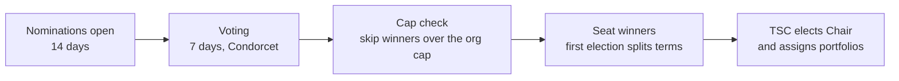
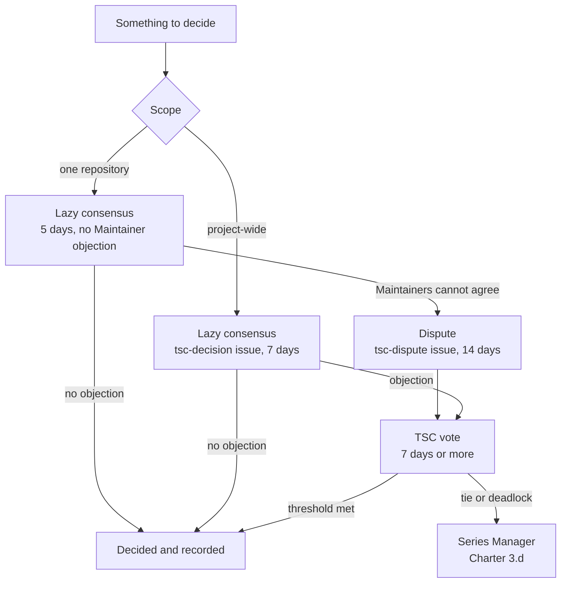
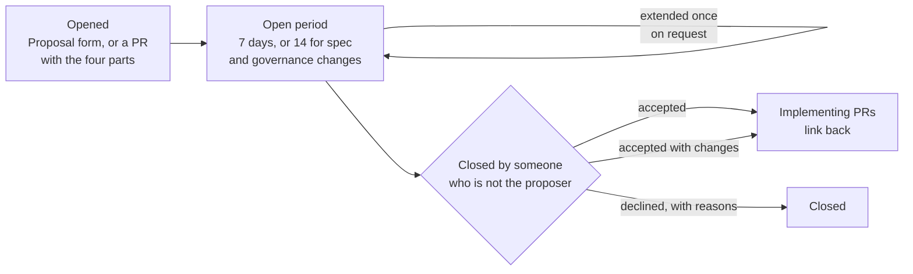
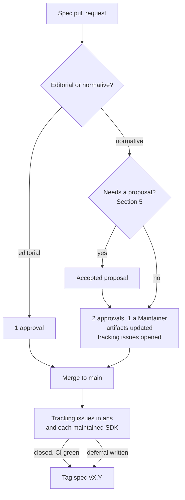
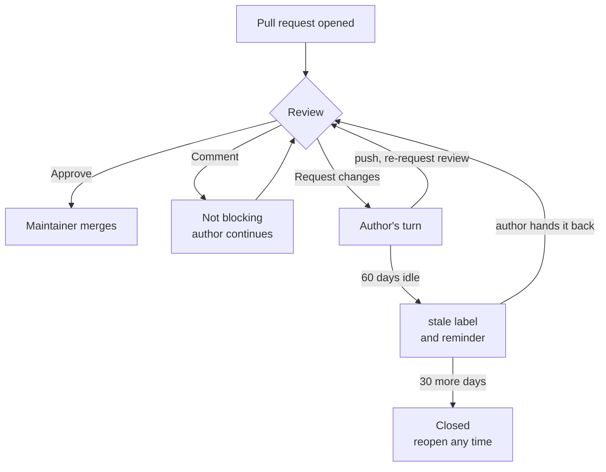

# ANS Project Governance

This document describes how the Agent Name Service (ANS) project makes
decisions and runs its repositories. The Technical Charter
([CHARTER.md](CHARTER.md)) is the legal foundation and wins if the two
disagree. Roles are defined in [CONTRIBUTOR_LADDER.md](CONTRIBUTOR_LADDER.md),
referred to below as the Ladder.

## 1. Principles

- **Open by default.** Discussion, proposals, votes, and decisions happen in
  public, in writing, on GitHub. Private conversation is fine for
  coordination and for security or conduct matters, but decisions are not
  made there.
- **Asynchronous first.** Nobody has to attend a call to take part. Every
  call is recorded and written up, so nobody has to be there to know what
  happened.
- **Lazy consensus for the routine, votes for the rest.** Section 4 says
  which is which. Nothing technical is ever decided by silence: code and
  specification changes need explicit approvals.
- **Responsibility follows access.** Write access comes with an expectation
  of responsiveness. Roles that go unused are given up. The Ladder says how.
- **Neutral.** The project belongs to no single company. The review rules
  here and the TSC composition cap in the Charter exist to keep it that way.

## 2. What this governs

The project is every repository in the `agentnameservice` GitHub
organization. The current list, with Maintainers, is
[MAINTAINERS.md](MAINTAINERS.md). Licenses are set by Charter Section 7.

`agent-trust-discovery` is included in the project donation.

Not governed by this document:

- The process of any standards body the specification is submitted to.
  That body's rules govern the submission.
- The HCS-14 and HCS-27 specifications, which follow the Hiero community
  process.
- The Agentic AI Foundation (AAIF) and its working groups, unless and until
  the project applies to and is accepted by AAIF (see Section 13).

## 3. Technical Steering Committee

### 3.1 Composition

- **Seats.** Five at adoption. The TSC grows to seven at the first election
  and to nine at the second, so that widening participation is scheduled
  rather than left to the incumbents. A seat with no eligible candidate stays
  vacant. Vacant seats do not count toward quorum, the organization cap, or
  any voting threshold, so a majority is always more than half of the seated
  members: three of five, four of seven, five of nine. The TSC may hold its
  size at the current level, or reduce it toward five, by two-thirds vote
  (Section 4.2). Never fewer than five and never more than nine (Charter 2.d).
- The Charter (Section 2.d) caps one organization and its affiliates at fewer
  than half of the seated voting members, from the end of the Startup Period
  or the first election, whichever is first. During the Startup Period the
  appointed TSC may exceed the cap; the first election brings it into
  compliance. If an election cannot seat five compliant members, incumbents
  continue in the seats that cannot be filled and the TSC may run over the cap
  until a by-election fixes it; while it does, Charter amendments, license
  exceptions, and changes to the election rules need at least one vote from
  outside the largest organization (Charter 2.d). Write access through the TSC
  team or an officer role does not make anyone a Maintainer for eligibility
  here or in Section 3.3.
- During the Startup Period defined in the Charter, the members are those
  listed in [TSC.md](TSC.md). The first election must complete within
  12 months of Charter adoption. If it slips, the startup members continue
  to serve until it is held, and the Vice Chair, then any member, may start it
  (Section 3.3).

### 3.2 Elections

This is the contribution-based approach the Charter (Section 2.c) requires
the TSC to adopt before the Startup Period ends.

- **Terms.** Two years, staggered so that about half the seats are elected
  each year. At the first election, the top-ranked half of the winners
  (rounded up) take two-year terms and the rest take one-year terms. No
  limit on re-election.
- **Who can run.** Any Maintainer or Reviewer (see the Ladder) who has held
  that role for at least six months. This applies to sitting TSC members
  too. A seat is not, by itself, a qualification to keep it; a startup
  appointee who wants to stay past the first election becomes a Reviewer or
  Maintainer first.
- **First election.** For the first election only, anyone who is a Maintainer
  or Reviewer when nominations open may run. The six-month minimum does not
  apply, because the roles will not have existed that long.
- **Who votes.** Every Member, Reviewer, or Maintainer with qualifying
  activity in the preceding twelve months (the Ladder says what counts), and
  every sitting TSC member. One vote per person, however many roles they
  hold. Candidates are still limited to Reviewers and Maintainers.
- **Schedule.** Nominations open for 14 days. Voting runs for 7 days.
  Candidates post a short statement in the nomination issue.
- **Method.** A Condorcet method (for example CIVS) or another method the TSC
  picks and announces before nominations open. The Vice Chair runs the
  election, or asks LF staff to; if there is no Vice Chair, or the Vice Chair
  is a candidate, the Chair asks LF staff.
- **Cap enforcement.** If the results would put an organization over the
  Charter cap, the affected lowest-ranked winner is skipped and the next
  ranked candidate from a different organization is seated.
- **Unfilled seats.** If the cap leaves a seat with no eligible candidate,
  the incumbent in that seat continues to serve until the next annual
  election; a new seat with no eligible candidate stays vacant. Either way the
  TSC opens a by-election as soon as an eligible candidate from a different
  organization exists. If that leaves fewer than five seated or the TSC over
  the cap, the conflict rule in Section 3.1 applies. An election that seats
  every winner the cap allows counts as completed for Charter 2.b and 2.c.
- **Vacancies.** The TSC appoints a replacement by majority vote, subject to
  the Charter cap, to serve until the next election.

### 3.3 TSC Chair

The Chair is the project lead in the operational sense. The role exists so
that the administrative work of running an open source project has an owner.

- The initial TSC elects the Chair by majority vote as one of its first
  actions following Charter adoption (Charter 2.h). The Chair is also elected
  after each TSC election and whenever the office is vacant. Elections,
  resignations, and removals are recorded in [TSC.md](TSC.md). Except for the
  waiver below, the Chair must be a Maintainer of at least one
  project repository; the Chair runs the organization and should work in it.
  Serves until replaced or resigning. Removable by TSC majority at any time.
- **Initial Chair and Vice Chair elections.** The Maintainer requirement is
  waived for the first election of each office by the initial TSC following
  Charter adoption. Candidates must still be seated TSC members. This waiver
  covers those officers' initial terms only. Every later election, including
  a replacement election during the Startup Period, requires the person
  elected to be a Maintainer of at least one project repository.
- Duties:
  - Primary contact for LF Projects and the Series Manager. Answers LF
    requests within 10 business days.
  - GitHub organization owner. Keeps the owner list, teams, and repository
    permissions matching [TSC.md](TSC.md) and [MAINTAINERS.md](MAINTAINERS.md).
    Runs the annual access review (Section 9.3).
  - Opens and tracks votes and records every decision in `decisions/`.
  - Publishes the quarterly health check (Section 9.4).
  - Announces any TSC call at least seven days ahead, posts the recording
    link the same day, and the notes within seven days.
  - Makes sure the inactivity rules in the Ladder are actually applied.
- **Fallback.** If the Chair has not performed a duty in this document within
  its stated time, for example opening the quarterly health check by the
  fifteenth day of a quarter or opening a vote within three days, the Vice
  Chair may perform it, and failing that any TSC member. The rules do not
  wait for the Chair.
- The Chair may delegate specific duties, for example organization
  administration, to another TSC member or a Maintainer. Delegates are named
  in [TSC.md](TSC.md). The Chair stays accountable for them.

### 3.4 Expectations of TSC members

- Vote, or explicitly abstain, on every TSC vote.
- Reply to direct requests from the Chair or other TSC members within 14
  days.
- Disclose conflicts of interest when voting on something your employer has
  a stake in that other participants do not.
- **Inactivity.** A member who misses three consecutive votes, or who has not
  responded to TSC business addressed to them for 90 days, is contacted by
  the Chair. If there is no reply within a further 14 days, the remaining
  members may declare the seat vacant by majority vote. A quiet quarter with
  no votes or requests counts against nobody.
- **Removal for cause.** Two-thirds of the other TSC members, including at
  least one member from a different organization than the person being
  removed. Grounds are a Code of Conduct finding, repeated breach of this
  document, or an undisclosed conflict of interest that affected a decision.
  The person removed may refer the decision to the Series Manager (Charter
  3.d).

### 3.5 Advisors

The TSC may name Advisors under Charter 2.g. An Advisor is someone whose
judgment the project wants without the obligations of a seat: a specification
co-author, a liaison to another standards body, a deployer. Advisors are
listed in [TSC.md](TSC.md), may be asked for input on any proposal, and may
attend TSC calls. They have no vote, no access, and no commitments, and they
are not counted for quorum or the organization cap. The TSC names and removes
Advisors by lazy consensus.

### 3.6 Portfolios

Seats are elected at large and do not come with fixed jobs. At the start of
the Startup Period and after each election the TSC elects the Vice Chair the
way it elects the Chair (Section 3.3) and assigns the other portfolios to its
members, so the administrative work is not all on the Chair. One person may
hold more than one. The Vice Chair follows the same eligibility rules,
including the initial-election waiver in Section 3.3. Holders are listed in
[TSC.md](TSC.md).

| Portfolio | Owns |
| --- | --- |
| Chair | Section 3.3: LF liaison, organization owner, votes and decision records, the health check |
| Vice Chair | Stands in for the Chair; runs elections; second organization owner |
| Security | The [SECURITY.md](SECURITY.md) process: triage, embargo coordination, advisories |
| Community | Code of Conduct contact, Member requests, onboarding |
| Standards liaison | Relationships with standards bodies and other foundations (Section 13) |

## 4. Making decisions

### What needs a vote, a proposal, or just no objection

| Decision | How it is made |
| --- | --- |
| Amending the Charter; a license exception; changing the TSC size or an entrenched section; removing a TSC member; changing this document or the Ladder | Vote, at the threshold in Section 4.2 |
| Electing the Chair or Vice Chair; filling a TSC vacancy; appointing interim Maintainers | Vote, TSC majority |
| A new specification document or profile; a conformance target or level; a breaking change to a released wire format, schema, or public API; relaxing a released requirement; adding, archiving, or transferring a repository; taking on a hosted service | Proposal open for its waiting period, closed by the named closer (Section 5). The implementing change still needs its approvals. |
| Any change to code or specification text | Explicit approvals under Sections 6 and 7. Never by silence. |
| Promoting a Maintainer | Majority of the repository's Maintainers (the Ladder) |
| Reviewer nominations; naming or removing Advisors; quiet periods; moving an inactive Maintainer to Emeritus and reinstating one; routine repository decisions; any project-wide matter with no threshold above | Lazy consensus (Section 4.1). Anyone entitled may extend the window once (Section 4.4). |

### 4.1 Lazy consensus

- **Within a repository.** A Maintainer proposes something in an issue or
  pull request. If no Maintainer of that repository objects within five
  days, it is decided. Lazy consensus decides the question; it never merges
  anything. A pull request still needs its approvals under Sections 6 and 7,
  however long it has been open.
- **Project-wide.** A TSC member opens an issue in this repository with the
  TSC decision form (label `tsc-decision`), stating the proposal and
  mentioning the TSC team so every member is notified. The seven days run
  from the mention. If no TSC member objects within seven days, it is
  adopted and the Chair records it.
- An objection says why, and where possible what would resolve it. "I
  disagree" without reasons does not block; it is treated as a request for
  more time, the window extends once (Section 4.4), and the proposer asks
  for the reasons. Anyone who still cannot give them can put the question to
  a vote instead.
- Lazy consensus does not decide anything the Section 4.2 table assigns a
  threshold to, and it does not apply to disputes (Section 12).

### 4.2 Votes

- Any TSC member may call a vote on any question. The Chair opens an issue
  with the TSC vote form (title `[VOTE] ...`) within three days; if the Chair
  has not, the member who called the vote opens it. The issue states the
  question, the threshold from the table below (if members disagree on which
  row applies, the stricter one does), and the deadline, which is at least
  seven days out.
- Voting runs through the GitVote bot. A TSC member starts it by commenting
  `/vote`, or `/vote-two-thirds` for a two-thirds row in the table below.
  Members vote with the bot's reactions: in favor, against, or abstain. Only
  TSC members' votes count. The vote stays open until its deadline, so nobody
  is recorded as missing a vote that closed before they could see it; the bot
  posts the tally when it closes. For a removal vote the Chair checks the
  tally by hand, because the person concerned does not vote. The Chair
  records the result in `decisions/`.
- Thresholds:

  | Question | Threshold |
  | --- | --- |
  | Amend the Charter | Two-thirds of all TSC members, then LF Projects approval (Charter 8.a) |
  | License exception | Two-thirds of all TSC members (Charter 7.c) |
  | Remove a TSC member for cause | Two-thirds of the other TSC members |
  | Change this document or the Ladder | Majority of all TSC members after a 14-day comment period |
  | Change the TSC size, or Sections 3.1, 3.2, 3.4, 4.2, 9.3, or 14 of this document | Two-thirds of all TSC members after a 14-day comment period; during the Startup Period, including at least one vote from outside the largest organization |
  | Anything else, electronically | Majority of all TSC members (Charter 3.c) |
  | Anything else, on a call with quorum | Majority of those present (Charter 3.c) |

  Every threshold counts seated members only. Vacant seats never count.

- A vote about a named person, such as removal for cause or a conduct
  finding, may be taken by private ballot in closed session (Section 11). The
  tally and the outcome are still recorded publicly.
- A tie fails. The question may be raised again after 30 days. If it ties
  again, the status quo holds.
- If the TSC cannot resolve a vote, any TSC member may refer it to the
  Series Manager (Charter 3.d).

### 4.3 Recording

Every TSC decision, whether by consensus or vote, gets a numbered record in
[decisions/](decisions/) using [templates/decision-record.md](templates/decision-record.md).
The record links to the issue where the decision was made.

### 4.4 Asking for more time

Every waiting period in this document and in the Ladder is a minimum. Any
TSC member may extend a project-wide window once, and any Maintainer of the
repository may extend a repository-level window once, by saying so in the
thread before it closes. The extension is for the same length as the original
window. No reason is needed. A second extension needs the agreement of
whoever opened the item.

## 5. Proposals

Most changes go straight to a pull request, including ordinary normative
specification changes. A proposal is for changes other people need warning
about before they land. These always need one:

- Adding a new specification document, identity profile, or discovery
  profile, or deprecating one. Profiles count because each one adds a value
  to a closed list in the base schema that every implementation has to
  recognize, and removing one later breaks deployed data.
- Adding or removing a conformance target or conformance level.
- A breaking change to a wire format or schema that has shipped in a tagged
  specification release, or to an SDK's public API.
- Removing or relaxing a requirement that a released implementation depends
  on.
- Adding, archiving, or transferring a repository.
- Any change to [CHARTER.md](CHARTER.md), this document, the Ladder, or the
  voting-member table in [TSC.md](TSC.md).
- Taking on a hosted service the project depends on, such as a shared test
  environment.

Everything else goes through the review rules in Sections 6 and 7 without a
proposal.

Process:

1. Open an issue with the Proposal form in the affected repository (this
   repository for governance, repository, and hosted-service
   proposals). It applies the `proposal` label and asks for the problem, the
   proposal, alternatives, and compatibility. A pull request may serve as
   the proposal instead if its description has the sections in
   [templates/proposal.md](templates/proposal.md); the waiting period then
   runs before merge.
2. Leave it open at least seven days, or 14 days for a specification change
   or a governance change. Anyone may comment, and anyone entitled to may ask
   for more time (Section 4.4). The proposer responds and revises.
3. Someone who is not the proposer closes it with one of `accepted`,
   `accepted-with-changes`, or `declined`, with reasons:
   - a Maintainer of the affected repository, for specification, SDK, and
     reference implementation proposals;
   - a TSC member, for repository and hosted service proposals, with a
     decision record (Section 4.3);
   - the Chair, for governance and Charter proposals, after the vote that
     Section 14 or Charter 8.a requires; the closing comment links the
     decision record.
   If no eligible closer exists, for example when the proposer is the
   repository's only Maintainer, a TSC member closes it. If the people
   entitled to close it disagree, Section 4 applies.
4. Pull requests that implement the proposal link back to it.

Whatever form it takes, a proposal has four parts: the problem and who it
affects; the proposed change, quoting current and proposed text for a
normative change; the alternatives considered and why they were not chosen;
and compatibility, meaning existing deployments and data, the machine-readable
artifacts affected, and the implementations that will have to change.

Spec, SDK, and reference implementation proposals are closed by a Maintainer
of the affected repository. Repository and hosted service proposals
are closed by a TSC member with a decision record. Governance and Charter
proposals are closed by the Chair after the required vote.

## 6. Changing the specification

The specification repository is `ans-spec`. Its `main` branch is the
living specification.

### 6.1 Classifying a change

Both `ans-spec` and `trust-index-spec` use this classification.

- **Editorial.** Examples, diagrams, wording, structure. No change to what an
  implementation must, should, or may do.
- **Normative.** Anything that adds, removes, or changes an RFC 2119 / RFC
  8174 keyword requirement, a field, a schema, a conformance level, or the
  meaning of an existing requirement.

The author applies exactly one of the `editorial` or `normative` labels.
Any Maintainer may relabel it. If Maintainers disagree, it is normative.

### 6.2 Review requirements

| Change | Needs |
| --- | --- |
| Editorial | One approval from a specification Maintainer or Reviewer who is not the author. |
| Normative | An accepted proposal when Section 5 requires one. Two approvals from specification Maintainers or Reviewers who are not the author, at least one of them a Maintainer. When the roster allows, at least one approver from a different organization than the author. Machine-readable artifacts (schemas, OpenAPI, test vectors) updated in the same pull request. A tracking issue opened in the reference implementation and in each maintained SDK before merge. |

The review and implementation-coordination requirements in this section apply
to `ans-spec`. The linked SDK and reference-implementation issues track the
work needed to support those changes. Their pull requests, and those in
`trust-index-spec`, follow the code review rules in Section 7.

If the specification review pool is unavailable, the fallback-review rule in
Section 7 may supply a missing approval. Normative changes still need two
approvals, including one from a specification Maintainer, and any required
proposal.

A specification Maintainer merges. Sections 7.1 and 7.2 (review states and
inactive pull requests) apply to specification pull requests too.

### 6.3 Specification releases

Merging to `main` is not publishing. A normative change is published when it
appears in a tagged specification release (`spec-vMAJOR.MINOR`). Tagging a
release requires, for each normative change since the last tag:

- the reference implementation and each maintained SDK have closed their
  tracking issue with the change merged, and their CI passes against the
  release's conformance vectors, **or**
- the Maintainers of a lagging implementation have written in the release
  issue that they are deferring, and why. If an implementation has no
  active Maintainers, the TSC records the deferral and reviews its maintenance
  status at the next health check.

Conformance vectors are versioned with the specification. Each SDK's README
states the specification version it implements.

### 6.4 Standards submissions

The TSC may submit a snapshot of the specification to a standards body. The
submission follows that body's process and does not change how the repository
is governed. Where a submitted snapshot and the repository differ, the
repository is what implementations follow.

## 7. Changing code

This applies to every repository in the organization other than
`ans-spec`, which Section 6 covers. Changes to `governance`, `.github`,
and the package taps count as release or CI tooling and need two approvals.
For `governance`, the TSC holds the review and merge role; for `.github`, the
Chair and Vice Chair hold the merge role. These roles take the place of
Maintainer in this section for those two repositories. The document-specific
decision thresholds in Section 14 still apply.

- Every pull request needs one approval from a Reviewer or Maintainer of
  that repository who is not the author, a green CI run, and DCO sign-off on
  every commit. A Maintainer merges it, so a Maintainer always sees it before
  it lands.
- Two approvals, at least one from a Maintainer, for changes to: public API,
  wire formats and serialization, cryptographic or verification logic, and
  release or CI tooling.
- If a repository does not have enough other Reviewers and Maintainers
  available, a TSC member or a Maintainer of another project repository may
  give the missing approval. Record the reason in the pull request. This
  exception does not reduce the approval count, waive a required Maintainer
  approval, or permit self-approval.
- The TSC team has Write access and CODEOWNERS eligibility across active
  project repositories so its fallback approval can satisfy GitHub's review
  checks. A cross-repository Maintainer must also have Write access and any
  required code-owner eligibility before their review can satisfy those
  checks. Fallback review does not grant merge authority.
- GitHub cannot limit a code-owner approval to periods when other reviewers
  are unavailable. The merging Maintainer checks the recorded reason and the
  normal review requirements; the TSC's technical eligibility is not a general
  substitute for repository review. Merges remain restricted to the
  repository's Maintainer team, with the governance-role exceptions above.
- Commit titles follow Conventional Commits (`feat:`, `fix:`, `docs:`,
  `spec:`, ...) because releases are cut from them.
- AI-assisted contributions are disclosed as described in
  [CONTRIBUTING.md](CONTRIBUTING.md).

**Review response.** A pull request gets a first reply from one of the
repository's Maintainers or Reviewers within 10 calendar days, even if
only to say who will review it and when. There is no deadline for finishing
a review or approving; the 10 days exist so a contributor is never left
wondering whether anyone saw the pull request. This is an expectation on the
repository's reviewing pool as a group, not on each person. Anyone marked
away in `MAINTAINERS.md` is not counted, and nothing happens to an individual
who misses it. What happens instead is escalation: after 20 days with no
reply the author may ask any TSC member, who may assign a reviewer or review
it themselves. A repository whose reviewing pool has not responded to anything
for 30 days is under-maintained; the TSC may appoint interim Maintainers
(Section 9.4).

**Quiet periods.** A repository's Maintainers may declare quiet periods, for
example the last two weeks of December, by listing the dates in
`MAINTAINERS.md`. Project-wide quiet periods are declared by the TSC by lazy
consensus and listed in the governance repository's `MAINTAINERS.md`. During
a quiet period the reply expectation is suspended and the days do not count
toward the 20 and 30 day thresholds above. A reviewer is never held to the 10
days while marked away, and a pull request is never held against its author
because reviewers were on holiday.

### 7.1 Review states and whose turn it is

Both sides should be able to tell from the pull request page whose turn it
is. GitHub's review states are how that is tracked, for specification and
code alike.

- Reviewers use a formal review, not loose comments. Blocking feedback is
  **Request changes**. Feedback that does not block is a **Comment** review
  and says so. **Approve** means approve. A comment-only review neither
  blocks nor counts as an approval.
- After "Request changes" it is the author's turn. When the author has
  addressed the feedback they use **Re-request review** on that reviewer.
  That is what notifies the reviewer and hands it back. An @-mention is not a
  substitute.
- After a re-request the reviewer has the same 10 days to respond as for a
  first review. If that reviewer is marked away, the author re-requests from
  another Reviewer or Maintainer instead.
- A "Request changes" is cleared by that reviewer re-reviewing. If they have
  not responded 20 days after a re-request, another Maintainer of the
  repository may dismiss the review, saying why in the dismissal, and review
  in their place.
- Approvals are dismissed automatically when new commits are pushed after
  them (Section 9.2). The author re-requests review after pushing.
- Authors who disagree with requested changes say so in the thread rather
  than resolving the conversation. Every conversation is resolved before
  merge, by the reviewer who opened it or by the merger with a note saying
  why.

### 7.2 Inactive pull requests

A pull request that has waited on its author for a long time hides real work
and makes the health check numbers meaningless. One waiting on reviewers is
the project's problem, not the author's, and is never closed for inactivity.

- A pull request is waiting on its author when a reviewer from the
  repository's reviewing pool has requested changes and the author has not
  pushed and re-requested review since, or when required checks fail on the
  head commit and a reviewer has said so in a comment. A pull request that
  nobody from the reviewing pool has commented on is waiting on reviewers,
  whatever its checks say. Activity means commits or comments by the author.
  It is inactive after 60 days without activity.
- At 60 days the inactivity workflow (or a Maintainer) comments asking
  whether it is still being worked on and adds the `stale` label.
- After a further 30 days with no change it is closed with a comment saying
  it can be reopened at any time by pushing to the branch or asking. The
  linked issue stays open. Closing the pull request does not mean the idea
  is dead.
- The label comes off when the pull request is no longer waiting on its
  author, which normally means pushing changes and re-requesting review, or
  when a Maintainer removes it.
- Draft pull requests are exempt from the workflow. A Maintainer checks on
  drafts older than 90 days during the health check.
- Issues are not closed for age alone. An issue labeled `needs-info` with no
  reply for 60 days may be closed the same way, reopenable on request.

A workflow enforces this. It reads the review state and the pending review
requests, so a pull request with an unanswered re-request, or with no
reviewer comment at all, is treated as waiting on reviewers and is never
labelled or closed.

## 8. SDK maintenance

Every maintained SDK follows the same specification-change coordination process
in Sections 6.2 and 6.3. Each SDK's README states the specification version it
implements, and its CI runs the relevant specification conformance vectors.

The TSC reviews Maintainer capacity and outstanding specification implementation
work at every quarterly health check. A deferral is recorded under Section 6.3;
a repository that lacks active Maintainers is handled under Sections 7 and 9.4.
[MAINTAINERS.md](MAINTAINERS.md) identifies each repository’s team and links
to its current membership.

## 9. Repositories and the GitHub organization

### 9.1 Adding and archiving

Adding a repository needs a proposal (Section 5). The proposal says what the
repository is for and how it relates to the specification, who the initial
Maintainers are (at least two), the license under Charter Section 7, how it
will be tested and released, and how it will track specification changes. The TSC
accepts a repository when it serves the mission directly rather than merely
using ANS; brings its governance and any trademarks or other assets under the
project; has at least two committed Maintainers; meets the baseline in Section
9.2 and the security policy; has a credible plan for testing, releases, and
sustained maintenance; and does not duplicate an existing repository without a
stated reason. Archiving needs a proposal too. Archive rather than delete, and put a banner
in the README saying so.

### 9.2 Every repository has

- `LICENSE` matching the Charter, and SPDX identifiers in source files.
- `README.md` stating what it is and which specification version it implements.
- `CONTRIBUTING.md`, `CODE_OF_CONDUCT.md`, `SECURITY.md` that point to this
  repository's versions.
- `MAINTAINERS.md` and a `CODEOWNERS` that names the relevant repository teams
  and `@agentnameservice/tsc` for fallback review. Include the TSC team on
  path-specific ownership rules too; a later rule overrides the catch-all.
- The organization's issue forms and pull request template, and the labels
  the process uses, which are kept in one place and synced to every
  repository.
- The DCO App check required on pull requests.
- Private vulnerability reporting enabled. SECURITY.md depends on it; the
  Security portfolio holder confirms it for every repository at each health
  check.
- Branch protection on the default branch: pull requests required, one
  required approval (the two-approval rule in Section 7 is applied by the
  merging Maintainer; `CODEOWNERS` routes review to the repository teams and
  the TSC fallback team), required status checks including DCO, no force pushes.
  Require branches to be up to date before merging. Dismiss stale approvals
  when new commits are pushed. Require conversation
  resolution before merging. Require review from Code Owners. Restrict pushes
  and merges to the repository's Maintainer team. In `governance`, this is the
  TSC team; in `.github`, it is the Chair/Vice Chair team. TSC review access
  gives no bypass on other repositories. Do not allow bypassing these review,
  DCO, or CI requirements for administrators.
- Workflows that check pull request titles and linked issues, and handle
  inactive pull requests. Specification repositories also check for exactly
  one of the editorial or normative labels.
- Dependency update automation.

### 9.3 Organization settings

- Two-factor authentication required for all members.
- Organization owners are the TSC Chair, the Vice Chair, and the Linux
  Foundation staff account. Nobody else. The list is updated within 14 days
  of a change of Chair or Vice Chair.
- The organization security manager role is held by the Security portfolio
  holder and one named backup, so private vulnerability reports reach the
  response team (SECURITY.md).
- Each repository's `MAINTAINERS.md` identifies its Maintainer and Reviewer
  teams. Their GitHub membership and access are recorded in
  [`.github/peribolos.yml`](https://github.com/agentnameservice/.github/blob/main/peribolos.yml)
  and applied by Peribolos after review. Membership changes require the
  affected repository's approvals under the Contributor Ladder.
- The voting-member table in `TSC.md` remains the authority for TSC
  appointments. Its approved membership is reflected in the `tsc` team's
  configuration. That team has Write access and code-owner eligibility for
  fallback reviews; this does not appoint repository Maintainers or add the
  TSC to project merge allowlists.
- `CODEOWNERS` names the appropriate teams. Access is granted through teams,
  not to individuals directly. An organization owner ensures the reviewed
  team configuration is applied within seven days of a membership change.
- Members cannot create repositories. Repositories are created by an owner
  after a proposal is accepted.
- **Annual access review.** Each year the Chair compares owners, security
  managers, teams, and repository permissions against [TSC.md](TSC.md) and
  the team configuration and repository `MAINTAINERS.md` references, removes
  anything that does not match,
  and posts the result.

### 9.4 Quarterly health check

Every quarter a workflow in this repository opens the health check issue with
the numbers filled in, and the Chair completes it. Per repository: commits, pull requests merged, median time
to first review, open issues, Maintainer activity against the Ladder
thresholds, SDK maintenance status, open proposals older than 30 days, and anything
outstanding with LF. This is where inactivity rules get applied and
under-maintained repositories get interim Maintainers. It is boring on
purpose.

## 10. Releases

- SDKs and the reference implementation use semantic versioning, cut
  releases with `release-please` from Conventional Commits, and keep a
  `CHANGELOG.md`.
- Security fixes ship as patch releases as soon as they are ready.
- Deprecations are announced at least one minor release before removal and
  the deprecated behavior stays for at least six months.
- Specification releases follow Section 6.3.
- **Hosted test environments.** The TSC may designate one or more. Whoever
  hosts one is named in [MAINTAINERS.md](MAINTAINERS.md). They hold no
  production data and availability is best effort.

## 11. Communication

- GitHub issues, pull requests, and discussions are the primary channel.
  TSC business happens in this repository.
- Announcement channels will be established after the donation completes.
  Nothing is decided in chat.
- **Meetings.** There are no standing meetings. The TSC or a repository's
  Maintainers may call one. It is announced at least seven days ahead in an
  issue with an agenda, open to anyone. The recording link is posted the
  same day and the notes within seven days. The LF Antitrust Policy notice
  (https://lfprojects.org/policies/antitrust-policy/) is read at the start.
  Votes taken on a call are valid under Charter 3.c, but the TSC prefers
  electronic votes so absent members can take part.
- **Recordings.** Calls are recorded, everyone is told so at the start, and
  the recording is linked from the notes. A vote on a call is taken by each
  member saying yes, no, or abstain, recorded by name in the notes, and it
  still gets a decision record.
- **Closed sessions.** Meetings are open by default. The TSC may close a
  session only to decide a Code of Conduct finding or an appeal about a named
  person, to handle an embargoed security report, to receive legal advice, or
  to discuss personal data. It announces that the session is closed and why,
  records publicly who attended and what the outcome was, and keeps the
  discussion confidential. Nothing else is decided in closed session.

## 12. Disputes

- Day-to-day disagreements about a change are resolved by the reviewing
  Maintainers of that repository.
- If Maintainers cannot agree, either side opens a `tsc-dispute` issue. The
  TSC seeks consensus for 14 days, then votes under Section 4.2. Lazy
  consensus under Section 4.1 does not apply to disputes.
- If the TSC deadlocks, Charter 3.d applies and the Series Manager is asked
  to help.
- Role decisions (promotion, removal, inactivity) can be appealed as the
  Ladder describes.

## 13. Relationships with other bodies

- **Standards bodies.** If the TSC submits the specification to one
  (Section 6.4), that body's process and IPR rules govern the submission.
- **Agentic AI Foundation.** Once the project has a track record under LF
  governance, the TSC may apply for admission to AAIF. Admission would put the
  project under AAIF's governance in addition to this document; the TSC
  decides whether to apply by two-thirds vote.
- **Hiero / Hashgraph Online.** HCS-14 and HCS-27 are governed by the Hiero
  community process. The project coordinates on compatibility but does not
  govern them.

When a decision affects both this project and an external body, the TSC
coordinates with that body and does not try to override its process.

## 14. Changing this document

Open a proposal (Section 5). Leave it open 14 days. It passes with a majority
of all TSC members (Section 4.2). Changes are recorded in `decisions/`.
Changes to Sections 3.1, 3.2, 3.4, 4.2, 9.3, or this section need two-thirds
of all TSC members, and during the Startup Period at least one vote from
outside the largest organization.

Who may change each document:

| Document | Changed by |
| --- | --- |
| CHARTER.md | Two-thirds of all TSC members, then LF Projects (Charter 8.a) |
| GOVERNANCE.md, CONTRIBUTOR_LADDER.md | Majority of all TSC members after a 14-day proposal (Section 5); two-thirds for the entrenched sections above |
| TSC.md voting-member table | Only to record a Section 3 event, with a decision record |
| `peribolos.yml` project-team membership | Maintainers of the affected repository approve the PR; `.github` administrators merge and apply it |
| MAINTAINERS.md hosted environments | Proposal closed by a TSC member (Section 5) |
| MAINTAINERS.md project-wide quiet periods | TSC lazy consensus (Section 4.1) |
| CONTRIBUTING.md, SECURITY.md, CODE_OF_CONDUCT.md, templates/ | TSC lazy consensus (Section 4.1); a project-specific Code of Conduct also needs Series Manager approval (Charter 4.b) |
| RATIONALE.md, README.md | Any TSC member by pull request; not normative |
