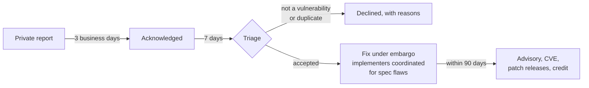

# Security Policy

ANS is identity infrastructure. A flaw in the specification, a reference
implementation, or an SDK can affect every deployment. Please report
problems privately and give us time to fix them before publishing.

This policy applies to every repository in the `agentnameservice`
organization. Each repository's `SECURITY.md` points here.

## What to report

- Vulnerabilities in the reference implementation (`ans`), any SDK, or the
  trust index.
- Flaws in the specifications: anything that lets an attacker impersonate an
  agent, forge or replay a badge, receipt, or certificate binding, hide an
  event from the transparency log, or pass verification they should fail.
- Weaknesses in the conformance vectors or schemas that would let a
  non-conforming implementation appear to pass.

## How to report

Preferred: use **GitHub private vulnerability reporting** on the affected
repository ("Report a vulnerability" under the Security tab). For a
specification flaw, use the
[ans-spec reporting form](https://github.com/agentnameservice/ans-spec/security/advisories/new).

The project security address is [security@ansinfo.ai](mailto:security@ansinfo.ai).
Activation is pending; use GitHub private reporting until it is active.

Do not open a public issue, pull request, or discussion about it, and do not
report it in chat.

Tell us: what is affected and at which version or commit, how to reproduce
it, what an attacker gains, and any fix you have in mind. Say if you want
credit and under what name.

## What happens next

| Step | Target |
| --- | --- |
| Acknowledgement | 3 business days |
| Triage decision (accepted, not a vulnerability, duplicate) | 7 days |
| Fix and coordinated disclosure | 90 days from report, sooner where possible |

The **security response team** for a report is the Maintainers of the
affected repository plus the TSC member holding the Security portfolio (see
`TSC.md`). For a specification flaw it also includes the Maintainers of the reference
implementation and every maintained SDK, because they all have to ship fixes
together.

GitHub delivers a private report to repository administrators and the
organization's security managers, not to Maintainers. The Security portfolio
holder and one named backup hold the security manager role. Until those
appointments are recorded, repository administrators coordinate the response.
Within one business day of a report, an administrator or security manager
adds the affected repository's Maintainers, and for a specification flaw the
SDK Maintainers, as collaborators on the advisory. If you have no
acknowledgement after five business days, follow up in the private report.

For specification flaws we may bring known deployers and implementers under
embargo before disclosure so fixes can land at the same time. We will tell
you if we do.

We will keep you informed and may ask for more detail. If we decline a
report we will say why.

## Disclosure

When the fix ships we publish a GitHub Security Advisory on each affected
repository, request a CVE, and credit the reporter unless they asked us not
to. Fixed versions ship as patch releases
(Section 10 of [GOVERNANCE.md](GOVERNANCE.md)).

If a report is being exploited in the wild, or the reporter's deadline is
shorter than ours, we shorten the timeline rather than argue about it.

## Supported versions

Each repository states which release lines get security fixes in its own
`SECURITY.md`. By default that is the latest minor release.

## Safe harbor

We will not pursue legal action against, or report to law enforcement,
anyone who reports in good faith, avoids privacy violations and service
disruption, only tests against systems they own or have permission to test,
and gives us reasonable time to fix the problem before disclosing it.

## Changes to this policy

The TSC owns this document (Charter Section 2.i.vi). Changes go through the
normal governance process.
